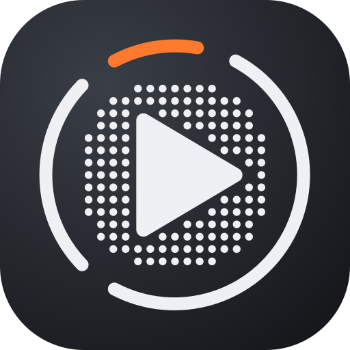

<p align="center">
  
</p>

<h1 align="center">Screen Cast</h1>

<p align="center">Free, self-hosted digital signage for any TV that has a web browser.</p>

Screen Cast is a single Node.js file. Run it on one PC on your network. From your laptop or phone you build playlists of pictures, videos, documents, web pages and text. Each TV opens a web page and plays the playlist it is given. You don't need a cloud account, an internet connection or a player box.

## Features

- **Playlists per screen:** pictures, videos, web pages and text, each shown for as long as you set.
- **Documents:** PDF, PowerPoint and Excel files are turned into one picture per page.
- **Live status:** see which TVs are live, connected or offline, make a TV show its name, or reload it.
- **TV pairing:** a TV shows a 6-digit code and only plays once someone who is signed in types that code in. Each screen gets its own secret key.
- **Accounts and roles:** admins, editors (all screens, or only the ones assigned to them) and viewers. Passwords are stored as salted hashes. Repeated wrong passwords lock the address out, and idle sessions are signed out. An activity log records changes.
- **HTTPS for the control page**, with a certificate the server makes for itself.
- **Keeps playing when the server is away:** each TV holds its playlist's pictures and keeps showing them, and catches up when the server is back.
- **Upload safeguards:** limits on file size, free disk space and library size, and checks on file contents.
- **Light and dark looks** on the control page, in a soft neumorphic style with built-in fonts.

## Requirements

- Node.js 18 or newer. The server itself needs nothing else installed.
- TVs with a web browser on the same network. It was built for LG webOS TVs, and any browser works.
- Optional, for document uploads:
  - **PDF:** run `npm install` in the project folder.
  - **PowerPoint and Excel:** the above, plus [LibreOffice](https://www.libreoffice.org/) on the server PC.

## Quick start

1. Create the first admin account:

   ```sh
   node server.js set-password
   ```

2. Start the server:

   ```sh
   node server.js
   ```

3. Open the control page from your laptop or phone at `http://<server-ip>:8712/` and sign in as `admin`.
4. On each TV, open `http://<server-ip>:8712/tv` in its browser and pick the screen. You can also go straight to a screen, for example `http://<server-ip>:8712/tv3`.

The server prints its addresses when it starts.

## Pairing TVs

Switch pairing on from **Set up a TV** on the control page. TVs that are already connected are kept. After that:

1. A new TV that opens `/tv` shows a 6-digit code.
2. On the control page, select the screen, press **Pair a TV** and type the code.

The TV remembers its key. **Unpair its TVs** gives the screen a new key, so every TV playing it has to be paired again.

## HTTPS

```sh
node server.js make-cert
```

This makes a certificate for the PC's names and addresses and keeps it in `tvboard-data/tls`. From the next start:

- The control page is at `https://<server-ip>:8443/` and refuses plain HTTP, so passwords never cross the network unencrypted.
- The TVs keep using plain HTTP on port 8712.

Browsers warn about the certificate until you trust it. The command tells you how.

Run `make-cert` again when the PC's address changes or the certificate runs out, after about two years. To go back to plain HTTP, delete the `tls` folder.

## Updating

Replace `server.js` and restart it. Everything you have set up lives in the `tvboard-data` folder beside it: screens, playlists, uploads, accounts and the certificate. So:

- Never replace or delete `tvboard-data`.
- When moving the server to another folder or PC, move `tvboard-data` with it.

Sign-ins survive a restart. TVs only reload when the TV page itself has changed.

## Settings

All settings are optional environment variables.

| Variable | Default | What it does |
|---|---|---|
| `PORT` | `8712` | Plain-HTTP port. With HTTPS on, it serves the TV pages only. |
| `HTTPS_PORT` | `8443` | HTTPS port. |
| `TLS_CERT`, `TLS_KEY` | | Your own certificate and key, used instead of the one `make-cert` makes. |
| `BIND` | all networks | Listen on this one address only, for example `10.20.5.7`. |
| `ADMIN_ALLOW` | anyone | Addresses allowed to reach the control page, for example `10.20.5.0/24,10.20.9.14`. |
| `TV_ALLOW` | anyone | Addresses allowed to load the TV pages. |
| `IDLE_MINUTES` | `60` | Sign people out after this long without using the control page. `0` turns it off. |
| `DATA_DIR` | `./tvboard-data` | Where all data lives. |
| `MAX_UPLOAD_MB` | `1024` | Largest single upload. |
| `MIN_FREE_MB` | `2048` | Refuse uploads that would leave less free disk space than this. |
| `MAX_LIBRARY_MB` | no limit | Largest total size of the media library. |
| `TV_KEEP_MB` | `64` | Pictures each TV holds so that it keeps playing while the server is away. `0` turns this off. |
| `SOFFICE_PATH` | found automatically | Where LibreOffice's `soffice` program is. |

For example, in PowerShell:

```powershell
$env:IDLE_MINUTES = "30"; node server.js
```

## Security notes

- Run Screen Cast inside a private network only. Never expose it to the internet.
- Switch on TV pairing and HTTPS. Use `ADMIN_ALLOW` to limit who can reach the control page.
- Traffic to the TVs is plain HTTP. Putting the TVs on their own network or VLAN keeps it away from other devices.
- Back up `tvboard-data` regularly. It holds everything you have set up, including the certificate's private key, so keep backups private and never commit the folder. The included `.gitignore` already leaves it out.

## Limitations

- When the server PC is off, TVs keep showing the pictures they hold. A TV that is switched off and on, or reloads its page, shows nothing until the server is back.
- TVs do not hold videos. A video may keep playing from the browser's own copy, but that is not guaranteed.
- Changes reach the TVs only while the server is running.

## Fonts

The control page uses [Unbounded](https://github.com/googlefonts/unbounded) (Copyright 2022 The Unbounded Project Authors) and [Jost](https://github.com/indestructible-type/Jost) (Copyright 2020 The Jost Project Authors). Both are embedded in `server.js` under the [SIL Open Font License 1.1](https://openfontlicense.org).
